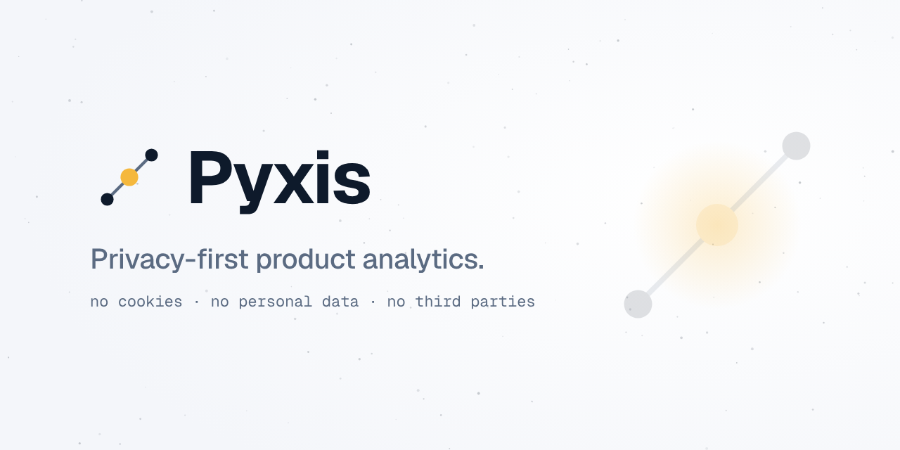
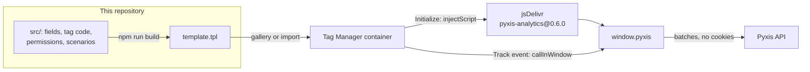

<div align="center">

<picture>
  <source media="(prefers-color-scheme: dark)" srcset=".github/assets/cover-dark.png">
  
</picture>

**The Google Tag Manager template of Pyxis: install the privacy-first tracker on any site that runs
Tag Manager, without writing code.**

[](https://github.com/samuelcsantana/pyxis-gtm-template/actions/workflows/ci.yml)
[](https://codecov.io/gh/samuelcsantana/pyxis-gtm-template)
[](https://github.com/samuelcsantana/pyxis-gtm-template/actions/workflows/codeql.yml)
[](https://scorecard.dev/viewer/?uri=github.com/samuelcsantana/pyxis-gtm-template)
<br>
[](LICENSE)
[](src/tsconfig.json)
[](https://www.conventionalcommits.org)

**[Pyxis](https://pyxis-analytics.dev)** · **[Live demo](https://demo.pyxis-analytics.dev)** ·
**[Tracker playground](https://samuelcsantana.github.io/pyxis-sdk/)**

</div>

> **Status:** waiting for `pyxis-analytics` 0.6.0, the tracker version the template loads, to reach
> npm; the template then goes to Tag Manager's Community Template Gallery.

## Ecosystem

| Repository                                               | Role                                                                      |
| -------------------------------------------------------- | ------------------------------------------------------------------------- |
| [pyxis-api](https://github.com/samuelcsantana/pyxis-api) | Ingestion, sign-in, dashboard queries, accounts and billing, erasure      |
| [pyxis-sdk](https://github.com/samuelcsantana/pyxis-sdk) | Browser tracker published to npm as `pyxis-analytics`                     |
| [pyxis-web](https://github.com/samuelcsantana/pyxis-web) | The dashboard and the home page                                           |
| [pyxis-mcp](https://github.com/samuelcsantana/pyxis-mcp) | MCP server: AI agents read the dashboard's numbers                        |
| **pyxis-gtm-template** (this one)                        | Tag Manager template that loads the tracker on sites without a build step |

## Why it exists

Installing the tracker takes code: an npm package, or a module script in the page. Store owners and
people who run their site on WordPress, a site builder or a hosted store usually cannot add either,
but many of them already have Google Tag Manager. This template puts Pyxis one tag away: paste the
project's public key, pick a trigger, publish the container.

What it loads is the same tracker, with the same promises: no cookies, no stored IP addresses, URLs reduced
to path templates, Global Privacy Control and Do Not Track honored
([the tracker's privacy rules](https://github.com/samuelcsantana/pyxis-sdk#privacy-by-design)).

## Install

1. In Tag Manager, open **Templates** › **Tag Templates** › **Search Gallery** and add **Pyxis
   Analytics**. Before it is listed, download [`template.tpl`](template.tpl) and use **New** › ⋮ ›
   **Import** instead.
2. Create a tag **Pyxis Analytics** with the action **Initialize** and your project's public key (the
   Pyxis dashboard shows it under Install). Trigger: **Initialization - All Pages**. Page views,
   including those of single-page apps, are then counted by the tracker itself.
3. For each event you want, create another tag with the action **Track event**, the event name and
   up to ten properties, on the trigger of that event. In its **Advanced Settings** › **Tag
   Sequencing**, fire the Initialize tag before it.
4. Add the site's address to the project's allowed origins in the dashboard, preview, publish.

## Fields

| Field                             | What it does                                                                                               |
| --------------------------------- | ---------------------------------------------------------------------------------------------------------- |
| Public key                        | `pyxis_pk_` and 32 letters and digits. Public by design: it only lets your sites send events               |
| Endpoint                          | Where events go. Default `https://api.pyxis-analytics.dev`                                                 |
| Action                            | **Initialize** loads the tracker and counts page views; **Track event** sends one named event              |
| Event name                        | `^[a-z][a-z0-9_]{0,63}$`, not `page_view`, `identify` or `api_request` (reserved)                          |
| Event properties                  | Up to 10 rows, names `^[a-z0-9_]{1,40}$`; typed values are text, a variable can send a number or a boolean |
| Respect analytics_storage consent | On by default; see below                                                                                   |

Never put personal data in an event name or property: no email, name, phone or document number.

## Consent

With **Respect analytics_storage consent** on (the default), while Consent Mode reports
`analytics_storage` as denied the Initialize tag does not load the tracker and Track event tags send
nothing; the tags still report success, so a tag sequence goes on. Tag Manager counts a consent type
that was never set as granted, so a site without Consent Mode is measured.

A visitor who accepts later is measured from the next time an Initialize tag fires: add the event
your consent banner pushes on acceptance as a second trigger of the Initialize tag (firing it twice
on a page is harmless; the tracker loads and starts once).

Pyxis sets no cookie and stores no IP address, but it keeps the current visit in the browser's
session storage. Turn the check off only when your consent banner already covers Pyxis another way.

## Nuvemshop

Paid Nuvemshop plans accept a Tag Manager container ID under **Configurações** › **Códigos
externos**. Nuvemshop blocks Custom HTML tags and custom JavaScript variables when an order is
completed; this is a tag template, not Custom HTML. Add every address the store answers on (the
`lojavirtualnuvem.com.br` one and your own domain) to the project's allowed origins.

## Privacy and security

The template asks Tag Manager for the narrowest permissions it needs, and the container shows them
before anyone adds it:

- **Injects scripts:** only `https://cdn.jsdelivr.net/npm/pyxis-analytics@0.6.0/dist/pyxis.global.js`,
  an exact version, never a range or `latest`. A new tracker version is a new template version, which
  Tag Manager announces to the containers that use it.
- **Accesses global variables:** reads `pyxis`, calls `pyxis.init` and `pyxis.track`; nothing else.
- **Reads consent state:** `analytics_storage`, read only.
- **Logs to console:** only in Preview and debug mode.

## Architecture



`template.tpl` is generated. The tag code is TypeScript (`src/template.ts`): the body of its `run()`
becomes the template's sandboxed JavaScript, transpiled to ES2015 and formatted. The `src` project
compiles against the ES5 library and ESLint rejects the syntax and globals the sandbox lacks, so the
code stays within what Tag Manager runs. CI fails when the committed `template.tpl` differs from what
the build writes.

## Tech stack

TypeScript (strict) · Tag Manager sandboxed JavaScript · Vitest · ESLint · Prettier · Node.js 24 ·
GitHub Actions

## Getting started

```bash
npm ci
npm run build       # writes template.tpl from src/
npm run test:cov    # tag code and editor scenarios, 100% coverage gate
```

[CONTRIBUTING.md](CONTRIBUTING.md) lists every script and how the template is built.

## Testing

- **Tag code:** Vitest imports `run()` and runs it against a fake sandbox that throws when the code
  reaches an API that `src/web-permissions.json` does not allow, as Tag Manager does. Coverage of
  `src/` is **100%** of statements, branches, functions and lines, enforced by Vitest's thresholds,
  with no exclusion.
- **Properties:** property-based tests with [fast-check](https://fast-check.dev)
  (`test/template.property.test.ts`) check the rules over generated tag data: exactly one outcome,
  nothing loaded or called while `analytics_storage` is denied, the key and endpoint passed on
  unchanged, a reserved or empty event name never sent and any other one sent as typed.
- **Editor scenarios:** `src/tests.yaml` becomes the template's Tests tab, written against Tag
  Manager's test API. CI runs the same scenarios under a stand-in for that API.
- **Fields:** the validators are tested against the tracker's rules (key, event name, property
  names, ten properties at most).
- **Build:** the build, the lint rule and the comment check have their own tests (`node --test`),
  which also compare `template.tpl` with `src/`.

## Project structure

```
src/
├── template.ts               # the tag code: run() becomes the sandboxed JavaScript
├── template-parameters.json  # the fields and their validators
├── web-permissions.json      # what the template may do in the page
├── tests.yaml                # the scenarios of the editor's Tests tab
├── info.json                 # name, category, description
└── terms-of-service.txt      # the gallery terms, as the editor exports them
scripts/build-template.mts    # assembles template.tpl
test/                         # fake sandbox, tag code, fields and editor scenarios
template.tpl                  # generated; what the gallery reads
metadata.yaml                 # gallery metadata: the versions submitted
```

## Contributing and license

Contributions are welcome: read [CONTRIBUTING.md](CONTRIBUTING.md) and the
[code of conduct](CODE_OF_CONDUCT.md). Report vulnerabilities privately, as [SECURITY.md](SECURITY.md)
explains.

Licensed under [Apache-2.0](LICENSE), which the Community Template Gallery requires of every
template repository; the other Pyxis repositories are MIT.
